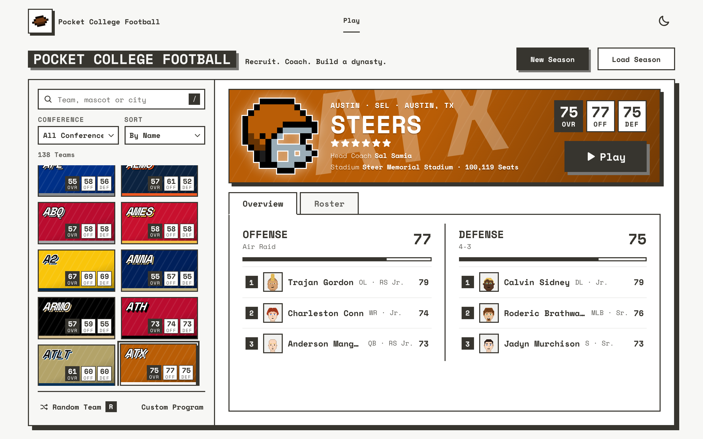
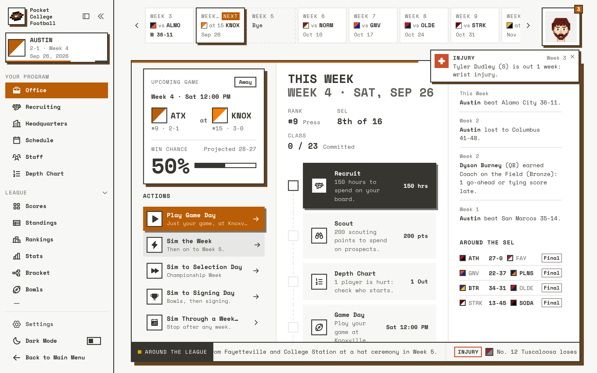
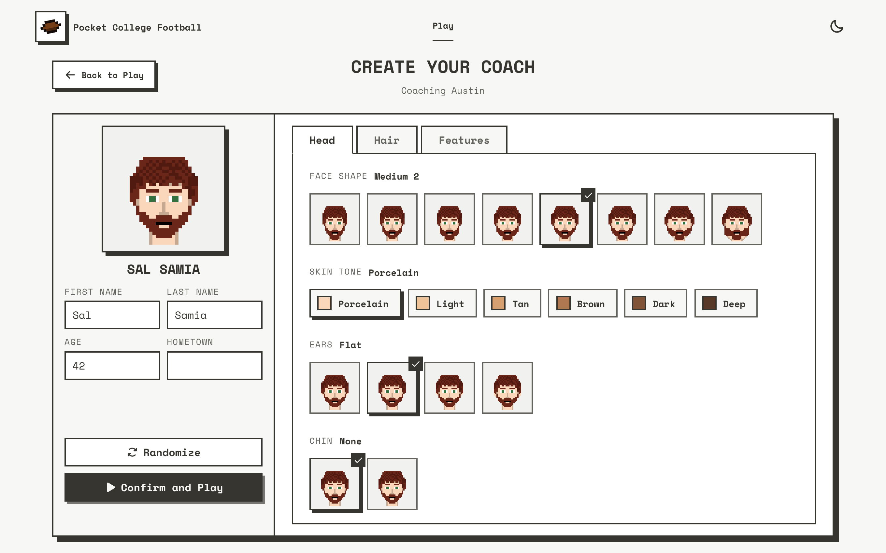

<h1 align="center">
  
  Pocket College Football
  
</h1>

<p align="center"><b>Play it: <a href="https://cfp-coach-simulator.vercel.app/">cfp-coach-simulator.vercel.app</a></b></p>



A college football coaching career that runs in the browser. You pick one of 138 programs, build your coach, and
take the team through the season, recruiting, the playoff and the bowls, and the offseason, year after year. The
whole game is JavaScript and runs on the device: there is no server, no account and nothing to install. The first
visit downloads the game and its data (about five megabytes); the browser keeps them for later visits.

## The Game


Each week of a season is **Recruit → Scout → Your Game → Advance**. You can play a week at a time or sim ahead to
any week, to Selection Day or to Signing Day.



- **Your Office.** This week's opponent, the week's steps, your program's news and the scores
  around your conference.
- **Game Day.** Every game is simulated play by play. Play your own, then advance the week to play everyone else's.
- **Recruiting.** A fictional class of about 4,000 high school seniors, none committed at the start. Each week you
  spend hours and scouting points to message, call, visit, host and offer. Every prospect wants something, a pitch
  counts by how strong your program really is on it, and every other school is recruiting him too. The committed
  sign on the early Signing Day; the rest sign after the title game.
- **Headquarters and Staff.** Your coordinators and scouts, the areas they cover, and what your program is built on.
- **Depth Chart.** Who starts and who is next, drawn on the field or as a list.
- **The League.** Scores, standings, the polls and the playoff rankings, stats, the 12-team bracket, every bowl, the
  season's awards and every program's standing.
- **The Offseason.** Keep Them Home, departures and the draft, four weeks of the transfer portal, player development,
  staff changes and the coaching carousel, conference moves and next year's schedule. Then the next season, with a
  new class to recruit and your program's history kept.


Every coach, player and recruit has a pixel-art face (`pocket-faces/`). Yours is the first thing you build.



Ratings are shown from 1 to 99, where the average player is about a 70.

### Good to Know

- **Saves stay on the device.** Careers are kept in the browser's storage. Clearing this site's data deletes them.
- **One tab at a time.** A second tab says the game is already open and waits, so two tabs never overwrite each
  other's saves.
- **The published names are made up.** See [Names on the Published Site](#names-on-the-published-site).
  A [skin](#skins) gives the game other names and rosters, in your browser only.

## Run It

All it needs is [Node](https://nodejs.org/) (22 is what the tests run on).

```
cd ui
npm install        # once
npm run dev        # the game on http://localhost:5173
```

`npm run dev` is the only process: Vite serves the app and the game the app's worker loads. The first start builds
the game's data from the rosters in `cfb_sim_data/` (some fifteen seconds), and so does the next start after a
roster or the game's code has changed. A change to the game's code while it runs rebuilds the game's script and
reloads the page. On Windows, `run.bat` does the last step. Run this way the game uses the source rosters, not the
lookalike names, and its saves are kept by the browser like anywhere else.

## How It Is Built and Published

```
cd ui && npm ci && cd ..
node tools/build_site.mjs --generic      # the published site, to ui/dist/
node tools/build_site.mjs                # the same with the source rosters' names
node tools/build_site.mjs --out DIR      # ... to another folder
```

The build copies the game and the app to a scratch folder (the repository is not changed), swaps the names there
when `--generic`, has the game make its own data, and writes a folder of plain files:

- the app (`npm run build` in `ui/`: Vite);
- `game.js`: the whole game as one script (`ui/game.entry.js`, bundled with esbuild);
- `worker.js` and `sim-worker.js`: the game's host in the browser and its helpers;
- `game-data.br` and `game-data.gz`: the game's data as one download, the data pack (brotli for a server that sends
  `Content-Encoding: br`, gzip for one that does not);
- `boot/`: the team picker's answers worked out ahead, so the first screen shows before the game has loaded;
- `skin.js`, `game.names.json` and `app.names.json` (a generic build): what lets the site take a [skin](#skins);
- `version.json`: the commit.

Packing the data is most of the build's time; `CFP_PACK_QUALITY=5` in the environment makes a quick build with a
larger download.

[Vercel](https://vercel.com/) publishes `main`: `vercel.json` runs `cd ui && npm ci`, then
`node tools/build_site.mjs --generic`, and serves `ui/dist/`. The site is files only. `vercel.json` also sends the
two cross-origin isolation headers the game's helper workers need to share memory, so anything the page loads from
another origin has to allow that (CORS or `Cross-Origin-Resource-Policy`).

## How the Game Is Hosted

The game is plain JavaScript modules with no dependence on a browser or on Node. A host loads `app_js/game.js` and
gives it three things: a way to read files, a store to write them to, and gzip for a career's save file.

- **In the browser** the host is a Web Worker (`ui/public/worker.js`). It loads `game.js`, downloads the data pack
  and keeps the game's files in memory. The page (`ui/src/gameClient.ts`) sends each call as a message
  (`GET /api/season/…`, as it would ask a server) and the worker answers from `app_js/api.js`. The folders that
  hold saves (`data/seasons/`, `data/coaches/`, `data/leagues/`) are written to IndexedDB after every call that
  changed a file, and read back when the game starts. A Web Lock keeps the store to one tab.
- **A week's games** are shared with helper workers (`ui/public/sim-worker.js`, the same `game.js`) over shared
  memory, so they run on several cores. Without cross-origin isolation the worker plays them itself.
- **On Node** the host is `tools/game_host.mjs`, which reads and writes a project folder's files. The build, the dev
  server, the tools and every test use it. The tools and tests keep what the game writes in a temporary folder.

A file is always a path from the repository's root (`data/schedules.json`) read through `engine_js/files.js`, so
the same code runs under either host.

## What Is Where

| Folder | What it holds |
| --- | --- |
| `ui/` | The app: React, Vite, TypeScript. `ui/PLAN.md` is its design rules and changelog. |
| `pocket-faces/` | The pixel-art faces, read by the app as source. |
| `engine_js/` | The play-by-play engine of one game, and the small runtime the whole game stands on (`pyrt.js`, `pystat.js`, `files.js`, `modules.js`). `engine_js/PORTING.md` explains why the code looks the way it does. |
| `sim_js/` | The season: schedule, the week's games, polls, awards, bowls and the playoff, news. |
| `teamdata_js/` | The rating scale, and the builder that makes the engine's teams from the rosters. |
| `career_js/` | The career: recruiting, the offseason, prospects, personas and scenes, the league, programs, the coaching carousel. |
| `app_js/` | `api.js`, every call the app makes, as plain functions; `game.js`, the whole game for a host. |
| `cfb_sim_data/` | The source rosters, coaches and preset faces. |
| `data/` | The data the game reads (schedules, models, history). The rosters as the game reads them are here too, committed (`engine_teams.json`, `player_potential.json`). The base league, saves and built leagues the game writes here are not committed. |
| `tools/` | The site build, the game on Node, the name swap (`tools/generic/`), skins (`make_skin.mjs`, `skin.mjs`, `skin_compare.mjs`) and the realism tools. |
| `tests/` | The tests, plain Node scripts. |

## Tests

The rosters the game reads (`data/engine_teams.json`, `data/player_potential.json`) are committed, so a fresh clone runs the tests as it is. They are the rosters themselves: nothing makes them, and a rating is changed by changing it there.

Each test is a script that exits with 1 when something fails:

```
node tests/test_career.mjs               # one test
node tests/run_all.mjs                   # every test, one at a time
node tests/run_all.mjs career stats      # the ones named
node tests/run_all.mjs --jobs 4          # four at a time
node tests/run_all.mjs --retry 1 --shard 2/4     # as the pull request check runs it, in four parts
```

`tests/harness.mjs` is what a test starts from: the whole game on Node, writing to a temporary folder.
`tests/test_sim_golden.mjs` holds two weeks of a seeded career to a recorded result, score for score and stat for
stat; `tests/test_generic_names.mjs` checks that a generic build holds no real name. `tests/run_all.mjs` lists two
tests that are known to fail (`test_scale`, `test_recruiting_realism`); it reports them without failing the run.

The app has no browser tests. Its gate, in `ui/`:

```
npx tsc --noEmit
npx stylelint "src/**/*.css"
npx prettier --check --end-of-line auto src
```

A pull request to `main` runs the gate and the tests (`.github/workflows/pr-tests.yml`) against the current `main`
and is merged when they pass (`pr-automerge.yml`).

### Realism Tools

These play whole seasons and print how the results compare with real ones. A season takes from half a minute to a
minute and a half, depending on the tool.

```
node tools/realism.mjs --seeds 2         # a season's stats against real FBS seasons; --check exits 1 outside the margins
node tools/check_recruiting.mjs 1        # a season's recruiting against the real classes it was learned from
node tools/long_run.mjs --seasons 30 --seed 1 --out data/long_run/seed1.json     # many seasons on Auto
node tools/long_run.mjs --report data/long_run/*.json                            # the summary over finished runs
```

`tools/speed_sweep.js` times every page of a built site with an automated browser; it needs Playwright, which is not
among the repository's dependencies.

## Names on the Published Site

Nothing published carries a real name. A generic build (`--generic`, and always on Vercel) swaps every school,
mascot, stadium, bowl, conference, trophy, award, player and coach for a lookalike, in the staged copy only. There
is one exception: a school named for its state or city goes by that place (Alabama, Texas, Houston), with its
mascot, stadium and full name still swapped.

- `tools/generic/tables.mjs` holds the hand-written lookalikes; `PLACES` there is the list of place-named schools.
- `tools/generic/scrub.mjs` applies them and draws a name with the same initials for every player and coach, the
  same one in every build.
- The preset faces are published. Only who a face belongs to is a name, so the swap renames those keys and leaves
  the face parts alone.
- `node tests/test_generic_names.mjs` is the gate: a new real name in the data or in the game's words needs a
  lookalike before it passes.

## Skins

A skin is one file a player loads on the published site's first screen (**Load a Skin**, beside Load Season) to see
other names and rosters: teams, players, coaches, stadiums, conferences, bowls, trophies and awards, everywhere in
the game. It stays in that browser (IndexedDB) and is there on the next visit; **Remove Skin** returns the site to
its own names. The site reads `.json` and `.json.gz`.

```
node tools/make_skin.mjs                       # skins/real-names.skin.json and .json.gz (some 90 MB and 8 MB)
node tools/make_skin.mjs --out FILE --name "Real Names" --id real-names
```

`make_skin.mjs` makes the skin that gives the published game the repository's own names and rosters: the game is
staged with the swap and without, and the skin is what differs.

**A skin is never published and never committed.** It holds exactly the names the published site must not carry.
It is written to a git-ignored place (`skins/`, `*.skin.json*`) and goes from there to the player. No build
contains one, and `tests/test_skin.mjs` holds the build to that.

How it works (`ui/public/skin.js` is the part the page and the game's worker share; `tools/skin.mjs` is the build's):

- **Data.** The skin holds the source data files that differ from the published ones, and the source rosters. The
  files the game makes itself (the engine's teams, the base league) are not in it: the browser makes them from the
  skin's rosters with the site's own code, the way the build does, once (some half a minute), and again only when a
  new version of the site would make them differently. So a skin keeps working when the site is updated.
- **Words in the site's scripts.** The generic build publishes, beside `game.js` and the app's script, a list of
  the spots where a name stands (`game.names.json`, `app.names.json`: where, how long, and a 16-bit mark of the
  name that belongs there; never a name). To make the lists the build builds both scripts a second time from the
  source names (never published), reads the two as programs and compares them piece by piece. The browser writes
  the skin's names into those spots before it runs the script.
- **Careers.** A skin's careers are kept in a store of their own (team ids differ between skins), so the lists never
  mix; taking a skin off deletes none of them, and they are back when it is loaded again.
- **A skin cannot run code.** Its names are written only at the spots the site lists, each inside a string or a
  property's name, and only when they are plain name text (no backslash, backtick, dollar sign, brace, angle
  bracket or line break); a quote is written escaped. Its files can only stand in for the game's own data files
  (`data/`, `cfb_sim_data/`), never a save. A file that is not a skin, or is one of another format (`FORMAT` in
  `skin.js`: raise it when a skin made before a change can no longer be read), is refused with a sentence.
- `npm run dev` and a build without `--generic` already show the source names: there the control is not shown.

`node tests/test_skin.mjs` proves the round trip on Node (the skin applied to the generic build's data and script
gives the source build's data, file for file, and the same career). `node tools/skin_compare.mjs` asks the same of
two built sites in a browser: every answer of a seeded career and every page's text.

## Branches

- `main`: the game as published. Changes land by pull request.
- `v0`: the first site (the old `web/` UI).
- `v1`: Clear Mode, before the React app.
- `v2`: the React app with the old rosters and ratings.
- `v3`: the last version with the game in Python (run in the browser through Pyodide).

`v0` to `v3` are kept as they were.
