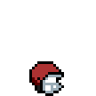
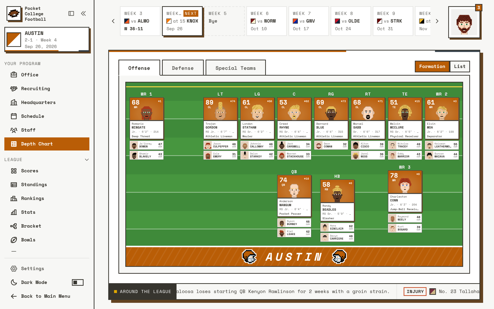

<h1 align="center">
  
  Pocket College Football
  
</h1>

<p align="center"><b>Recruit. Coach. Build a dynasty.</b></p>

<p align="center"><b>Play it now: <a href="https://cfp-coach-simulator.vercel.app/">cfp-coach-simulator.vercel.app</a></b></p>


A college football coaching career in your pocket. Take one of 138 programs through the season to the playoff and
the bowls, recruit your classes, run the offseason, and keep going season after season. It is free and runs in any
browser. There is nothing to install and no account to make.

> The whole game runs in your browser. The first visit downloads it (about five megabytes);
> after that your browser keeps it, so later visits start faster.

## Your Career


Pick a program, build your coach, and start a season. Each week is **Recruit → Scout → Your Game → Advance**, played
a week at a time or simmed as far ahead as you like.


- **Your Office.** This week's opponent and your chance to win, the week's steps, the play and sim buttons, your
  program's news and the scores around your conference.
- **Game Day.** Play your own game, then advance the week to play everyone else's. Or sim the week, sim to Selection
  Day, sim to Signing Day, or sim through any week and stop there.
- **Recruiting.** A fictional class of about 4,000 high school seniors, and nobody committed at the start. Each week
  you spend hours and scouting points: message, call, visit, host and offer. Every prospect wants something, a pitch
  counts by how strong your program really is on it, and every other school is recruiting him too. Recruiting closes
  after Championship Week; everyone committed signs on the early Signing Day, the rest after the title game.
- **Headquarters and Staff.** Your coordinators and scouts, the areas they cover, and what your program is built on.
- **Depth Chart.** Who starts and who's next, on the field or as a list.
- **The league.** Scores, standings, the polls and the playoff rankings, stats, the 12-team bracket, every bowl,
  the season's awards, and every program's standing.
- **The ticker.** Upsets, routs, poll moves, big days and commitments from around the league crawl along the bottom
  of the window all season.
- **Season Recap.** The season, told after it's done.
- **The offseason.** Keep Them Home, departures and the draft, four weeks of the transfer portal, development
  (players grow toward their potential, and a hard year can cost one a step), staff changes and the coaching
  carousel, conference moves and next year's schedule. Then the next season, with a new class to recruit and your
  program's history kept.



## Your Coach

Every coach, player and recruit has a pixel-art face. Yours is the first thing you build: head, hair and features,
then a name and a hometown.


## Player Ratings

Ratings run from 1 to 99 on the game's own scale:

| Rating       | Meaning                                         |
| ------------ | ----------------------------------------------- |
| 50           | An average starter in the top four conferences  |
| 65 / 80 / 95 | One, two and three steps above that             |
| About 40     | A typical backup there, or a starter a level down |
| 99           | The top of the scale                            |

## Good to Know

- **Saves stay on the device.** Your careers are kept in your browser's storage. Clearing this site's data deletes
  them.
- **One tab at a time.** A second tab says the game is already open and does not start, which keeps the two from
  overwriting each other's saves.
- **The names are made up.** The published game uses lookalike schools, mascots, bowls, conferences, awards, players
  and coaches (`tools/generic`). Any resemblance is the point; none of them are the real thing.

## Run It Yourself

```
cd ui
npm install                        # once
npm run dev                        # the game on http://localhost:5173
```

All it needs is Node. `npm run dev` serves the app and the game it runs in the browser (the first start builds the
game's data from the rosters in `cfb_sim_data/`, some fifteen seconds; so does the next start after a roster or the
game's code changes). On Windows, `run.bat` does the last step. Run this way the game uses the source rosters, not the
lookalikes, and its saves are kept by the browser.

`node tools/build_site.mjs --generic` builds the published site to `ui/dist/`: the app, the game as one script, its
data as one download and every name swapped. Vercel runs it on every merge to `main`.

### What Is Where

- `ui/`: the app (React, Vite, TypeScript). `ui/PLAN.md` is its changelog and design rules.
- `pocket-faces/`: the pixel-art faces.
- `app/api.py`: every route the app calls.
- `sim/`, `engine/`: the season and the play-by-play game.
- `coach_career/`: recruiting, the offseason, the coaching carousel, programs.
- `teamdata/`: builds the engine's teams from the source rosters; the game's rating scale.
- `tools/`: the site build and the name swap (`tools/generic`).
- `data/`, `cfb_sim_data/`: the data the game reads.
- `tests/`: the engine's tests, plain scripts (`python tests/run_all.py`, or one file at a time).

### Branches

- `main`: the game as published. Changes land by pull request; the tests run first.
- `v0`, `v1`: the two earlier versions, kept as they were.
