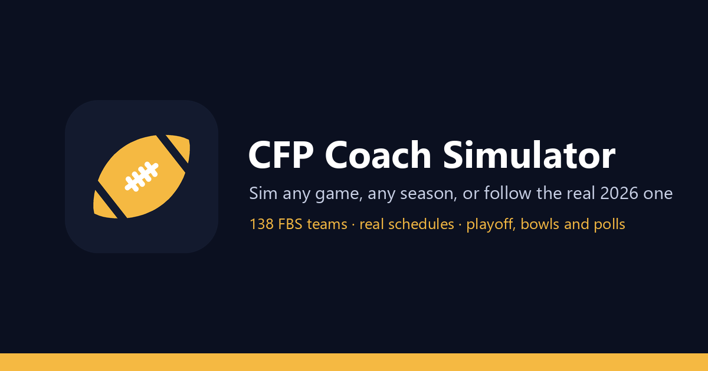

# CFP Coach Simulator



**Play it now: <https://cfp-coach-simulator.onrender.com/>**

A college football simulator built on the real 2026 season. Pick any two of 138 FBS
teams and play a game, take one school through a full season to the playoff and the bowls,
or follow the real 2026 season as it happens. It is free and runs in any browser, phones
included. There is nothing to install and no account to make.

> The free server goes to sleep when nobody is using it. If the page is slow the first
> time, give it up to a minute to wake up.

## Three ways to play

### Sim a game

Pick a home team and an away team, or put them on a neutral field, and press **Sim Game**.
Every game comes with:

- the score by quarter and every scoring play;
- team stats and player stats for both sides;
- a drive chart.

**Sim batch** plays the same matchup up to 500 times and shows how often each team wins.
**Sliders** let you change how the game plays, such as home-field advantage.

### Coach Career

Pick your team and start a season. **New season** plays the whole 2026 schedule from week 1.
**Start from today** picks up the real season where it stands, with the real results, polls,
player stats and box scores so far, and you play the rest. Then play a week at a time or
jump ahead.

- **Game day.** Play your own game drive by drive, then advance the week to play
  everyone else's.
- **This week.** Your next opponent, your odds and the matchup. You see the result as
  soon as the game is played.
- **Polls and the playoff.** A weekly AP Top 25 that moves the way real voters move it,
  and the committee's rankings from November. The 12-team bracket is set on selection
  day, then come the playoff and every bowl game.
- **The committee's resume.** Each team's best wins, worst losses and strength of
  schedule, the way the committee looks at them.
- **Rivalry trophies.** Every trophy game, who holds it and the all-time series.
- **Awards.** A Heisman race all season, every national award, All-America teams and
  all-conference teams.
- **Stats, standings and box scores.** Every team and player, all season long.
- **Players and depth charts.** Each player's card shows the ratings that matter at that
  position, with a full list one tap away.
- **Momentum and morale.** Turn them on in Settings. Swings carry inside a game, hot and
  cold streaks carry from week to week, and player cards show the boost or slump with
  green or red arrows.
- **God mode.** Turn it on in Settings to edit any player and any depth chart in the
  country.

### Real 2026

The actual 2026 season, read-only. It has every real result and box score, the real AP
polls with their vote points, standings, and projected bracket and bowls. It also has real
player stats with game-by-game logs and a Heisman race on the real numbers. Pick any team
to follow it.

## Player ratings

Ratings start from EA College Football's ratings and run from 1 to 99 on our own scale:

| Rating | Meaning |
|---|---|
| 50 | An average starter in the Power 4 conferences |
| 65 / 80 / 95 | One, two and three steps above that |
| About 40 | A typical Power 4 backup or Group of 5 starter |
| 99 | The top of the scale |

Rosters follow how teams really play in 2026. Depth charts and who gets the ball are
updated from the real box scores, so the real starting quarterback and lead back usually
start in the sim too.

## How realistic is it?

The engine is tuned against FBS season averages, and most team stats land within about a
tenth of the real numbers. Upsets happen about as often as they do on real Saturdays.

The picks are tested honestly. Before each week's real games, the sim's picks are saved
and never changed, then scored once the games are final. With the current engine and the
2026 rosters, it picks about 6 in 10 winners on those weeks. The betting favorite wins
about 7 in 10.

## Add it to your phone

On iPhone, open the site in Safari, tap **Share**, then **Add to Home Screen**. On
Android, open it in Chrome and choose **Install app** or **Add to Home screen** from the
menu. It opens full screen with its own icon.

## Good to know

- **Saved seasons can reset.** The free server forgets saved seasons when it restarts or
  goes to sleep. Finish a season in one sitting if you want to keep it.
- **This is a fan project.** It is not affiliated with the College Football Playoff, the
  NCAA, any conference or any school. Schedules, results and stats come from public
  sources.

## Run it on your own computer

You need Python 3.12.

```
pip install -r requirements.txt
python server.py
```

Then open <http://127.0.0.1:8000>. Phones on the same Wi-Fi can open the address the
server prints when it starts.

To learn how it works, including the engine, the data, hosting, calibration and the test
tools, read [docs/HOW_IT_WORKS.md](docs/HOW_IT_WORKS.md).
